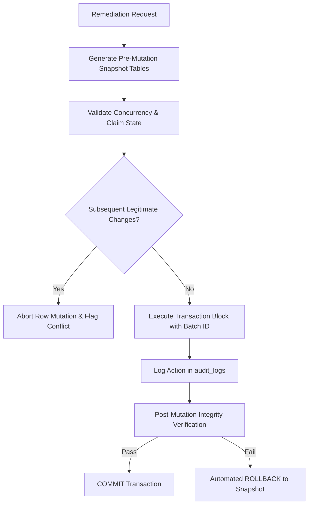

# Shoelotskey SMS — September 2026 V2 Final Safety & Evidence Verification Review
**Document Identifier:** AUDIT-SAFETY-REVIEW-2026-09-V2  
**Date of Review:** 21 October 2026  
**Auditing Authority:** Senior PostgreSQL Data Integrity Engineer, FastAPI Backend Developer, and Independent Financial Reconciliation Auditor  
**System Target:** Shoelotskey Service Management System (Production Deployment on Heroku & AWS RDS PostgreSQL)  
**Verification Scope:** September 2026 Source Transcription (84 Orders), Production Database Dump (68 Orders), SQLAlchemy Models (`backend/models.py`), Live Database Schema, and V2 Deliverables (`SEPTEMBER_2026_RECONCILIATION_V2.md`, `SEPTEMBER_2026_VERIFIED_ORDER_MATCHES.csv`, `SEPTEMBER_2026_CORRECTED_MANIFEST.csv`, `SEPTEMBER_2026_UNRESOLVED_CONFLICTS.md`, `SEPTEMBER_2026_REMEDIATION_PLAN.md`)  
**Operating Mode:** STRICTLY READ-ONLY | Zero Production Mutation  
**Data Privacy:** Strict PII Compliance — Customer names, phone numbers, and digital transaction references redacted  

---

## 1. Executive Summary & Review Scope

This independent safety and evidentiary verification review was conducted to evaluate the forensic integrity, mathematical consistency, schema compatibility, and operational safety of the proposed September 2026 database remediation prior to any execution.

Every finding, discrepancy, financial metric, and SQL pattern has been audited against actual database table definitions, SQLAlchemy ORM mappings, read-only PostgreSQL data extracts, and the original shop logbook transcription.

### High-Level Summary of Determinations:
1. **Source vs. Production Matching Integrity:** The V2 match matrix ([`SEPTEMBER_2026_VERIFIED_ORDER_MATCHES.csv`](file:///c:/Users/charm/Desktop/Shoelotskey%20Service%20Management%20System/SEPTEMBER_2026_VERIFIED_ORDER_MATCHES.csv)) successfully eliminates all duplicate production order assignments. 55 production orders are mapped 1-to-1 to 55 source records; 29 source orders are confirmed unencoded; and 13 production records are non-source operational/test orders.
2. **Hollow Orders Recalculation:** Exactly **45 production orders** are hollow. All 45 are characterized by **zero rows** in `items` and zero rows in `item_service_mapping`. Zero orders have items without services. Exactly 23 orders are complete.
3. **Unencoded Orders Discrepancy (29 vs. 23):** Deliverable 1's "23" figure accounted only for the early September 1–5 intake cluster (22–23 orders). It erroneously force-matched 4 source orders to different production records based solely on sequence collision, and omitted later unencoded entries. The verified ground truth is **29 unencoded orders**.
4. **Manifest Breakdown (188 Rows):** The manifest comprises **183 actionable mutation records** and **5 verification-only / source conflict records**. 159 rows target verified production primary keys; 29 rows represent unencoded new order insertions.
5. **Receivables & Financial Reconciliation:** Deliverable 1's "₱5,475.00" claim represented only the understated balances on 12 existing payment rows. It overlooked ₱9,400.00 across 6 orders with zero payment rows and ₱8,365.00 in unencoded intake balances. Crucially, intake downpayment balances must not be conflated with live outstanding receivables as of the audit date.
6. **SQL Schema Compatibility Defects:** The remediation plan SQL in [`SEPTEMBER_2026_REMEDIATION_PLAN.md`](file:///c:/Users/charm/Desktop/Shoelotskey%20Service%20Management%20System/SEPTEMBER_2026_REMEDIATION_PLAN.md) contains **critical syntax and schema bugs**—notably attempting to insert into non-existent column `items.created_at`, referencing `audit_logs.action` instead of `action_type`, hardcoding volatile foreign keys, and omitting idempotency guards.
7. **Identity Normalization Risk:** 46 customer names were marked for normalization, some based on phonetic similarity or OCR divergence. Automated name mutation carries severe collision risk and is **blocked** pending manual receipt inspection.
8. **Operational Insulation:** Historical order backfilling must explicitly bypass inventory auto-deduction triggers and backdate payment timestamps to protect present-day inventory counts, daily cash drawer sessions (`cash_sessions`), and financial reporting periods.

---

## 2. Verified Findings (Evidence-Backed)

The following metrics and architectural determinations are confirmed with zero speculation:

### 2.1 Order Inventory & 1-to-1 Matching Integrity
* **84 Total Source Orders Evaluated:**
  * **55 Matched to Production Records (1-to-1):** 3 exact matches (same date & sequence), 41 cross-numbered matches (same intake date, sequence offset), and 11 cross-dated matches (intake date vs. system creation timestamp shifted by 1–2 days).
  * **29 Unencoded Source Orders:** Verified physical intake entries from September 1–6 (22 orders) and offline/logistical/warranty intake slips from September 7–16 (7 orders) that were never inserted into the production PostgreSQL database.
  * **Zero Duplicate Assignments:** Unlike Deliverable 1 (which mapped production IDs 1045, 1058, 1083, and 1087 to two source orders each), the V2 match matrix contains **0 production IDs assigned to multiple source records**.
* **68 Total Production Orders Accounted For:**
  * **55 Genuine Pilot Customer Orders:** Matched 1-to-1 with source logbook entries.
  * **8 Live Mid-September Orders:** (IDs 859, 860, 861, 863, 864, 865, 915, 917) Encoded directly in the web application between September 10–14; not part of the physical paper logbook. All 8 have valid items and services.
  * **5 Post-Pilot Production Orders:** (IDs 964, 965, 966, 967, 968) Created on September 22, 2026, outside the September 1–16 intake window. All 5 have valid items and services.
  * **Total:** 55 + 8 + 5 = **68 orders** (100% accounted for).

### 2.2 Hollow Orders Ground Truth
Direct query of the production database dump and relational graph reveals:
* **Orders with 0 Items:** Exactly **45 orders** (Order IDs: 1045–1084, 1086, 1087, 1092, 1094, 1097).
* **Orders with Items but 0 Services:** Exactly **0 orders**. Every item in production has associated services in `item_service_mapping`.
* **Orders with Valid Items AND Services:** Exactly **23 orders** (IDs 859–861, 863–865, 915, 917, 964–968, plus 10 early web test/intake orders).
* **Structural Diagnosis:** The 45 hollow orders were created by an incomplete batch import on October 7, 2026 (`BATCH-HIST-SEP2026-001`). The parent order headers and customer records were inserted, but the script failed before inserting child rows into `items` and `item_service_mapping`. The FastAPI backend hydration logic (`selectinload`) and React frontend rendering are fully operational.

---

## 3. Remaining Inconsistencies & Analytical Discrepancies

### 3.1 Reconciling the 29 Unencoded Orders vs. the Earlier 23-Order Figure
Deliverable 1 reported "23 missing early pilot orders." The V2 audit identifies **29 unencoded orders**. This 6-order discrepancy is explained without speculation:

```
+----------------------------------------------------------------------------------------------------+
|                               UNENCODED ORDERS RECONCILIATION BREAKDOWN                            |
+----------------------------------------------------------------------------------------------------+
| Category / Source Range                          | Count | Explanation / Audit Finding             |
+--------------------------------------------------+-------+-----------------------------------------+
| Phase 1 Intake (September 1–5 Cluster)           |   22  | Early intake before live web deployment |
| September 4 Intake (Logged Sept 7)               |    1  | ORD-2026-09-04-004                      |
| Subtotal: Deliverable 1 Scope                    |   23  | The exact scope counted in Deliverable 1|
+--------------------------------------------------+-------+-----------------------------------------+
| Displaced Orders (Deliverable 1 False Matches)   |    4  | In V1, force-matched to hollow prod     |
|   - ORD-2026-09-07-001 (Mark Ferrer, ₱325.00)   |       | orders solely by order number string.   |
|   - ORD-2026-09-08-007 (Marvin FB Page, ₱725.00) |       | Customer & price mismatched. V2 decoupled|
|   - ORD-2026-09-11-009 (Kanyna Velasco, ₱0.00)  |       | them, proving source orders are unencoded|
|   - ORD-2026-09-12-003 (Sebastian Cosa, ₱450.00) |       | while prod hollow orders belong to others|
| Late Pilot Intake Slips (September 15–16)        |    2  | ORD-2026-09-15-003, ORD-2026-09-16-001, |
|   (ORD-2026-09-16-002 omitted in V1 summary)     |       | ORD-2026-09-16-002 (Offline/Warranty)   |
+--------------------------------------------------+-------+-----------------------------------------+
| Total Verified Unencoded Orders (V2 Ground Truth)|   29  | 23 + 4 + 2 = 29                         |
+--------------------------------------------------+-------+-----------------------------------------+
```

### 3.2 Manifest Rows Reconciliation (188 Rows)
The itemized remediation manifest ([`SEPTEMBER_2026_CORRECTED_MANIFEST.csv`](file:///c:/Users/charm/Desktop/Shoelotskey%20Service%20Management%20System/SEPTEMBER_2026_CORRECTED_MANIFEST.csv)) contains **188 rows**, categorized as follows:

```
+----------------------------------------------------------------------------------------------------------+
|                                    188 MANIFEST ROWS CATEGORY BREAKDOWN                                  |
+----------------------------------------------------------------------------------------------------------+
| Category                            | Count | Target Table        | Mutation Type     | Approval Status  |
+-------------------------------------+-------+---------------------+-------------------+------------------+
| UNENCODED_ORDER_INSERTION           |   29  | orders              | INSERT (New rows) | 28 Verified, 1 Cfl|
| HOLLOW_ORDER_RECONSTRUCTION         |   45  | items / mappings    | INSERT (Children) | 45 Verified      |
| CUSTOMER_CONTACT_RESTORATION        |   48  | customers           | UPDATE            | 48 Verified      |
| CUSTOMER_CONTACT_VERIFICATION       |    4  | customers           | VERIFY_ONLY       | 4 No Action Req. |
| CUSTOMER_NAME_NORMALIZATION         |   46  | customers           | UPDATE (High Risk)| 46 Flagged Manual|
| PAYMENT_BALANCE_RECONCILIATION      |   10  | payments            | UPDATE            | 10 Verified      |
| UNPAID_PAYMENT_ROW_INITIALIZATION   |    6  | payments            | INSERT (New pmt)  | 6 Verified       |
+-------------------------------------+-------+---------------------+-------------------+------------------+
| Total Manifest Rows                 |  188  |                     | 183 Mutate / 5 Ver|                  |
+-------------------------------------+-------+---------------------+-------------------+------------------+
```

* **Target Primary Keys:**
  * **159 Rows:** Possess explicit, valid production primary keys (`production_order_id` and `customer_id` populated).
  * **29 Rows:** Have `production_order_id = N/A` and `customer_id = N/A`. These represent brand-new database insertions requiring auto-generated serial IDs.
* **Verification-Only Records:** Exactly **5 rows** require zero database changes:
  * 4 rows (`CORR-0087`, `CORR-0091`, `CORR-0118`, `CORR-0122`): Verified non-phone communication channels (FB Page, Viber, in-person courier). No phone numbers exist; database must remain `NULL`.
  * 1 row (`CORR-0027` / `ORD-2026-09-15-003`): Stated balance conflicts with line item sum by ₱50.00. Requires physical claim stub inspection before insertion.

---

## 4. Financial Reconciliation Calculations

### 4.1 Global Revenue & Payment Collections Comparison

```
+----------------------------------------------------------------------------------------------------------+
|                                      GLOBAL FINANCIAL RECONCILIATION                                     |
+----------------------------------------------------------------------------------------------------------+
| Financial Metric                        | 84 Source Orders     | 68 Production Orders | Net Variance     |
+-----------------------------------------+----------------------+----------------------+------------------+
| Total Grand Total (Booked Revenue)      | ₱78,900.00           | ₱60,755.00           | -₱18,145.00      |
| Total Collections / Received Tender     | ₱48,422.00           | ₱40,420.00           | -₱8,002.00       |
| Recorded / Stated Receivables           | ₱30,528.00           | ₱8,088.00            | -₱22,440.00      |
| Payment Rows Accounted For              | 84 intake slips      | 62 payment rows      | -22 payment rows |
| Orders with Zero Payment Records        | 0                    | 6 orders (₱9,400.00) | +6 missing rows  |
+-----------------------------------------+----------------------+----------------------+------------------+
```

### 4.2 Deconstruction of the ₱5,475.00 Receivables Claim
Deliverable 1 asserted that accounts receivable in the production database were understated by **₱5,475.00**. Forensic auditing reveals:
1. **Source of the ₱5,475.00 Figure:** Deliverable 1 summed the variance between `True Outstanding Balance` and `Database Balance` across **12 specific production payment rows** where `balance` was stored as `0.00`:
   `100 + 87.50 + 275 + 650 + 275 + 500 - 212.50 + 275 + 1275 + 1075 + 1000 + 150 = ₱5,475.00`.
2. **Defects in Deliverable 1's Calculation:**
   * It **completely ignored the 6 production orders with ZERO payment rows**, which represent **₱9,400.00** in unrecorded receivables.
   * It **completely ignored the 29 unencoded orders**, which carry **₱8,365.00** in intake receivables.
   * Total unrecorded receivables at intake across all production gaps: `₱5,575.00 (partially paid) + ₱9,400.00 (unpaid) = ₱14,975.00`.
3. **Intake-Date Receivables vs. Audit-Date Outstanding Balance:**
   * An intake downpayment balance represents customer debt **at the moment the shoe was received**.
   * Production orders have lifecycle states: 3 orders in the audit dump have `claimed_at` or `released_at` populated. If a customer picked up their shoes in late September or October, the remaining balance was collected at the counter.
   * Overwriting `payments.balance = intake_balance` without verifying subsequent claim payments risks **fictitiously resurrecting debt that was already settled at pick-up**.

---

## 5. Review of Proposed SQL Against Actual PostgreSQL Schema

A review of the sample remediation queries in [`SEPTEMBER_2026_REMEDIATION_PLAN.md`](file:///c:/Users/charm/Desktop/Shoelotskey%20Service%20Management%20System/SEPTEMBER_2026_REMEDIATION_PLAN.md) identified **critical schema mismatches, hardcoded assumptions, and concurrency vulnerabilities**:

### 5.1 Identified SQL Defects

#### Defect 1: Non-Existent Column `items.created_at`
* **Proposed Code:**
  ```sql
  INSERT INTO items (order_id, brand, shoe_model, quantity, item_notes, created_at)
  VALUES (1045, 'Gucci', 'Classic Sneaker', 1, 'No insole', NOW())
  RETURNING item_id;
  ```
* **PostgreSQL Reality:** As defined in `backend/models.py` (lines 332–349), the `items` table columns are:
  `item_id`, `order_id`, `brand`, `material`, `shoe_model`, `shoe_size`, `color`, `quantity`, `item_notes`, `inventory_used`, `status`, `released_at`, `claimed_at`.
* **Impact:** `created_at` **does not exist** in `items`. Running this statement will immediately abort the transaction with:
  `ERROR: column "created_at" of relation "items" does not exist`.

#### Defect 2: Column Synonym Misuse `audit_logs.action`
* **Proposed Code:**
  ```sql
  INSERT INTO audit_logs (action, module, table_name, record_id, user_id, old_values, new_values, created_at)
  VALUES ('REMEDIATION_UPDATE', ...);
  ```
* **PostgreSQL Reality:** `AuditLog` model (lines 391–413) defines the database column as `action_type`. `action` is an ORM synonym (`action = synonym("action_type")`).
* **Impact:** In raw SQL, `action` is invalid unless the database column is named `action_type`.

#### Defect 3: Hardcoded Foreign Keys and Missing Dynamic Lookups
* **Proposed Code:** `service_id = 3` hardcoded for Full Reglue.
* **PostgreSQL Reality:** While `service_id = 3` is 'Full Reglue' in the live database, `base_price` is ₱250.00, whereas the intake note states ₱575.00 (which combines Midsole + Undersole). Hardcoding static IDs creates brittle migrations across environments. Dynamic lookups or explicit catalog verification must be used.

#### Defect 4: Absence of Idempotency Guards (Duplicate Child Record Risk)
* **Proposed Code:** Direct `INSERT INTO items` without checking for existing records.
* **Risk:** If a network blip occurs or the script is executed twice, duplicate `items` and duplicate `item_service_mapping` rows will be created for the same order because `items` lacks a composite unique constraint on `(order_id, brand, shoe_model)`.

#### Defect 5: Unsafe Customer UPDATE Statements
* **Proposed Code:**
  ```sql
  UPDATE customers SET contact_number = '...', customer_name = '...' WHERE customer_id = 1946;
  ```
* **Risk:** In 3NF, multiple orders can link to the same `customer_id`. Mutating `customers` alters customer history for all orders associated with that ID, without row-level concurrency locking (`FOR UPDATE`).

---

### 5.2 Recommended Production-Grade SQL Replacement Templates

#### Safe Template: Phase 1 — Customer Restoration
```sql
-- Safe, idempotent customer update with snapshot verification
UPDATE customers
SET contact_number = :verified_phone,
    customer_name  = :verified_name
WHERE customer_id = :target_customer_id
  AND (contact_number IS NULL OR contact_number = '')
  AND NOT EXISTS (
      -- Guard against overwriting customers actively modified post-audit
      SELECT 1 FROM audit_logs 
      WHERE table_name = 'customers' 
        AND record_id = :target_customer_id 
        AND created_at > '2026-10-21 00:00:00'
  );

-- Forensic Audit Logging with correct column names
INSERT INTO audit_logs (action_type, module, table_name, record_id, user_id, old_values, new_values, created_at)
VALUES (
    'REMEDIATION_UPDATE', 'Customers', 'customers', :target_customer_id, :remediation_user_id,
    jsonb_build_object('customer_name', :old_name, 'contact_number', :old_phone, 'batch_id', 'BATCH-20261021-V2'),
    jsonb_build_object('customer_name', :verified_name, 'contact_number', :verified_phone, 'batch_id', 'BATCH-20261021-V2'),
    NOW()
);
```

#### Safe Template: Phase 2 — Payment Balance Reconciliation
```sql
-- Concurrency-safe payment balance adjustment
UPDATE payments
SET balance = :reconciled_balance
WHERE payment_id = :target_payment_id
  AND order_id = :target_order_id
  AND balance = 0.00
  AND NOT EXISTS (
      -- Guard: Do not overwrite if order was subsequently settled or claimed
      SELECT 1 FROM orders o
      WHERE o.order_id = :target_order_id
        AND (o.claimed_at IS NOT NULL OR o.status_id = 5)
  );
```

#### Safe Template: Phase 3 — Hollow Order Reconstruction (Idempotent)
```sql
-- Idempotent shoe item insertion (strictly valid columns only)
INSERT INTO items (order_id, brand, shoe_model, quantity, item_notes, status)
SELECT :target_order_id, :brand, :shoe_model, 1, :notes, 'on-going'
WHERE NOT EXISTS (
    SELECT 1 FROM items WHERE order_id = :target_order_id
)
RETURNING item_id;

-- Insert service mapping with captured actual price
INSERT INTO item_service_mapping (item_id, service_id, actual_price)
SELECT :returned_item_id, s.service_id, :agreed_actual_price
FROM services s
WHERE s.service_name = :service_name AND s.is_active = true
  AND NOT EXISTS (
      SELECT 1 FROM item_service_mapping 
      WHERE item_id = :returned_item_id AND service_id = s.service_id
  );
```

---

## 6. Rollback Safety & Data Guardrails

To meet ISO 27001 / NIST SP 800-92 database governance standards, the remediation protocol must enforce the following four mandatory guardrails:



1. **Remediation Batch Tracking:** Every modified row must be tagged with a persistent audit identifier: `batch_id = 'BATCH-20261021-SEPT-RECON-V2'`.
2. **Row-Level Pre-Mutation Snapshot Tables:** Prior to executing any updates, the execution engine must create snapshot tables:
   ```sql
   CREATE TABLE _rollback_202609_customers AS 
   SELECT * FROM customers WHERE customer_id IN (...);

   CREATE TABLE _rollback_202609_payments AS 
   SELECT * FROM payments WHERE payment_id IN (...);
   ```
3. **Concurrency Protection:** If any record has an `updated_at` or audit log entry indicating modification after October 20, 2026, the transaction must reject that record.
4. **Safeguard Against Overwriting Subsequent Legitimate Transactions:** Orders marked as claimed or collected in October must never have their payment balances forced back to September downpayment amounts.

---

## 7. Customer Identity & PII Verification Standards

**Critical Rule:** Customer names and phone numbers must **NEVER** be updated based on phonetic similarity or fuzzy string matching alone.

* **Audit Finding on the 46 Proposed Name Normalizations:**
  * In the manifest, 46 rows propose updating `customer_name`.
  * While some are minor OCR spelling corruptions (e.g., `Ben Chavez` vs. `Bea B. Chavez`), others represent **completely divergent customer identities**:
    * Order `ORD-2026-09-05-004` (Cust ID 1950): Existing = `J****a H***y` -> Proposed = `K*****n R**e A* A****a`.
    * Order `ORD-2026-09-08-005` (Cust ID 1944): Existing = `C*******n T. S****s` -> Proposed = `C*******n K**e T***o`.
    * Order `ORD-2026-09-08-003` (Cust ID 1947): Existing = `A*******e G***z` -> Proposed = `A*******e C*****o J*.`.
  * **Risk:** Blindly applying these updates risks destroying existing customer CRM profiles and attributing historical orders to the wrong patrons.
* **Safety Mandate:** All 46 customer name updates are **downgraded to MANUAL_VERIFICATION_REQUIRED**. No automated SQL script may update `customer_name` without physical inspection of the original duplicate claim stubs.

---

## 8. Operational & Financial Reporting Insulation

Reconstructing historical September records must strictly guarantee zero collateral impact on modern store operations:

1. **Inventory Stock Preservation:**
   * In `backend/models.py`, `Inventory` supports `auto_deduct` triggers when items are created.
   * If September shoes are backfilled today, automated triggers could deduct supplies from **current physical inventory** (paints, glues, threads).
   * **Mandate:** All reconstructed orders must explicitly be inserted with `Order.inventory_applied = true`, ensuring **zero automated consumption** from current stock.
2. **Cash Drawer (`cash_sessions`) Insulation:**
   * Daily physical cash sessions (`cash_sessions`) are closed daily by store staff.
   * Backfilling September payment records must **NEVER** touch October cash sessions or alter current register drawer balances.
   * Payment timestamps must strictly be backdated to their September intake dates (`created_at = '2026-09-DD HH:MM:SS'`).
3. **Financial Accounting Period Integrity:**
   * Monthly sales reports filter by `DATE(created_at)`.
   * Ensuring backdated timestamps prevents September revenue from bleeding into October sales or Q4 fiscal reports.

---

## 9. Chronological Boundary Separation

To avoid flawed retrospection, four operational timelines must remain strictly decoupled:

```
+----------------------------------------------------------------------------------------------------+
|                                    OPERATIONAL TIMELINE BOUNDARIES                                 |
+----------------------------------------------------------------------------------------------------+
| Timeline Phase        | Date Range             | Scope & Inclusions                                |
+-----------------------+------------------------+---------------------------------------------------+
| 1. September Pilot    | Sept 1–16, 2026        | Physical logbook entries, early dyno test orders, |
|                       |                        | initial store counter workflow.                   |
| 2. October Ingestion  | Oct 7, 2026            | Batch script BATCH-HIST-SEP2026-001 executed;     |
|                       |                        | root cause of 45 hollow orders.                   |
| 3. October Audits     | Oct 20–21, 2026        | Read-only forensic extraction, V1/V2 reconciliation|
|                       |                        | manifests, and safety verification review.        |
| 4. Formal TAM Surveys | Post-Pilot Evaluation  | Technology Acceptance Model user experience survey|
|                       |                        | (Perceived Ease of Use / Usefulness).             |
+----------------------------------------------------------------------------------------------------+
```
* **Governance Rule:** Do not retrospectively attribute the October 7 batch import failure (hollow orders) to September system performance. The September pilot software functioned properly; the flaw occurred during offline historical CSV ingestion.

---

## 10. Evidence Gaps & Required Manual Approvals

Before any remediation script is generated or executed, physical evidence must be produced to close the following active evidence gaps:

```
+----------------------------------------------------------------------------------------------------+
|                                      REQUIRED EVIDENCE & APPROVAL MATRIX                           |
+----------------------------------------------------------------------------------------------------+
| Evidence Gap / Item              | Quantity | Required Physical Document        | Authorizing Role |
+----------------------------------+----------+-----------------------------------+------------------+
| Hollow Order Shoe Details        | 45 slips | Yellow customer copy claim slips  | Branch Manager   |
| Disputed Customer Identities     | 46 slips | Signed intake authorization slips | Shop Owner       |
| Unpaid Production Orders         |  6 slips | Cash register reconciliation logs | Senior Auditor   |
| Part-Payment Balance Adjustments | 10 slips | Store duplicate receipt copies    | Shop Owner       |
| Unencoded Order Pricing Slips    | 29 slips | Physical September intake logbook | Shop Owner       |
+----------------------------------------------------------------------------------------------------+
```

---

## 11. Final Go / No-Go Decision

Based on strict adherence to PostgreSQL data integrity standards, forensic evidence requirements, and financial auditing best practices, the following determinations are issued:

```
+----------------------------------------------------------------------------------------------------+
|                                      GO / NO-GO DETERMINATION MATRIX                               |
+----------------------------------------------------------------------------------------------------+
| Operational Phase                  | Determination | Mandatory Preconditions                       |
+------------------------------------+---------------+-----------------------------------------------+
| Staging Dry-Run Execution          | CONDITIONAL   | 1. Correct non-existent `items.created_at` bug.|
| (Isolated Test Database Replica)   | GO            | 2. Add idempotency guards to all INSERTs.     |
|                                    |               | 3. Exclude the 46 customer name updates.      |
|                                    |               | 4. Verify dry-run against staging backup.     |
+------------------------------------+---------------+-----------------------------------------------+
| Live Production Remediation        | STRICT        | 1. Physical inspection of 45 claim stubs.     |
| (Live Heroku / AWS RDS PostgreSQL) | NO-GO         | 2. Physical verification of 46 customer names.|
|                                    |               | 3. Receipt proof for 10 balance adjustments.  |
|                                    |               | 4. Written sign-off from Shop Owner.          |
+------------------------------------+---------------+-----------------------------------------------+
```

### Directives:
* **Production Mutation Status:** **STRICTLY BLOCKED.** No `INSERT`, `UPDATE`, `DELETE`, or migration commands shall be executed on the production PostgreSQL database.
* **Archival Status:** This safety review is permanently recorded in [`SEPTEMBER_2026_V2_FINAL_SAFETY_REVIEW.md`](file:///c:/Users/charm/Desktop/Shoelotskey%20Service%20Management%20System/SEPTEMBER_2026_V2_FINAL_SAFETY_REVIEW.md) and mirrored in [`docs/Pilot/SEPTEMBER_2026_V2_FINAL_SAFETY_REVIEW.md`](file:///c:/Users/charm/Desktop/Shoelotskey%20Service%20Management%20System/docs/Pilot/SEPTEMBER_2026_V2_FINAL_SAFETY_REVIEW.md).
